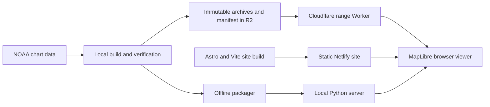

# CharTiles

**Open-source tools for turning NOAA Electronic Navigational Charts into
inspectable web map tiles.**

> **Experimental chart inspection. Not for navigation.** CharTiles derives
> its data from NOAA ENCs. Published builds can lag source updates, and
> conversion can introduce errors.

## Status

The public Puget Sound release covers a bounded pilot region. The viewer
shows NOAA raster imagery or lets you inspect vector features such as lights,
rocks, wrecks, and soundings. The project also provides an offline bundle
builder and a runnable MapLibre example.

- [Open the public site](https://chartiles.com/) or [inspection map](https://chartiles.com/inspect).
- [Integrate the Puget Sound archive](https://chartiles.com/integrate/) in a web map.
- [Watch the CUGOS lightning talk](https://chartiles.com/cugos/) or [read the blog](https://chartiles.com/blog/).
- [Read the implementation plan](docs/implementation-plan.md) for the inspection pilot and proposed work.

## What ChartTiles is

The local pipeline converts selected NOAA ENC features into a vector
[PMTiles](https://github.com/protomaps/PMTiles) archive and can import a
separate NOAA raster archive. The public map reads chart byte ranges through
a Cloudflare Worker backed by private R2 storage. The offline bundle serves
the map and selected archives from a local Python server. Chart builds and
publication are manual. GitHub Actions checks pull requests.

## Architecture in one diagram



The [architecture reference](docs/architecture/README.md) describes the current
system. The [ADRs](docs/adr/README.md) record why the technical choices were
made. The [hosting runbook](hosting/README.md) covers releases and public routes.

## Repository layout

| Path | What lives there |
| --- | --- |
| [`src/`](src/) | Astro templates, Verdant layout, and Markdown guide and blog |
| [`web/`](web/) | MapLibre inspection viewer and local chart artifacts |
| [`pipeline/`](pipeline/) | Chart acquisition, extraction, validation, and publishing |
| [`hosting/`](hosting/) | Cloudflare Worker and release instructions |
| [`onboard/`](onboard/) | Python HTTP range server for offline packages |
| [`talks/`](talks/) | CUGOS presentation and standalone copy |
| [`examples/`](examples/) | Developer quickstart for the published archive |
| [`tests/`](tests/) | Unit checks, chart fixtures, and browser tests |

## Documentation

Start with the [docs index](docs/README.md). For charts and coverage, see the
[Puget Sound benchmark](docs/puget-sound-benchmark.md) and
[coverage audit](docs/coverage-audit.md). For the next pilot, see the
[developer quickstart](docs/developer-quickstart.md) and
[sailor walkthrough](docs/sailor-walkthrough.md).

## Scope of v0.1

The current release covers the [configured Puget Sound region](docs/puget-sound-benchmark.md#scope)
using selected NOAA harbor-scale ENCs. [ADR-0004](docs/adr/0004-pacific-northwest-scope-for-v0-1.md)
sets the Pacific Northwest boundary for future expansion. Managed updates,
multi-scale coverage, routing, and full S-52 portrayal remain outside the
current release.

## Quick start

Use Node.js 24 and Python 3.10 or later. To build the Shilshole chart fixture
on macOS, install GDAL and tippecanoe first.

```sh
brew install gdal tippecanoe
npm ci
npm run charts
npm run build
npm run preview
```

Open the local URL printed by Vite. Use `npm run charts:puget` for the regional
archive. See the [Shilshole guide](docs/shilshole-prototype.md) for data
provenance and [offline packaging](docs/offline-bundle.md) for a portable ZIP.

To preview the complete site, use `npm run build:site` followed by
`npm run preview`. To run the browser suite, use the site build and install
the [browser fixtures](tests/fixtures/README.md) if you haven’t built charts.
[Site and blog workflow](hosting/README.md#publish-the-viewer)

## Contributing

Read the [ADRs](docs/adr/README.md) before proposing architecture changes.
Report unclear inspection behavior, coverage examples, or documentation gaps
in [GitHub Issues](https://github.com/ivanoats/chartiles/issues).

## License

The software is [MIT licensed](LICENSE). The viewer and archives credit NOAA
for the source data. See [ADR-0008](docs/adr/0008-mit-license-with-not-for-navigation-disclaimer.md)
for the project's licensing and safety decisions.
