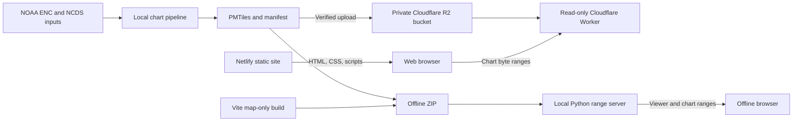

# Containers (C4 level 2)

The hosted site, data delivery, and offline bundle have separate entry points.

| Container or build | Responsibility |
| --- | --- |
| Local chart pipeline | Builds and validates the selected ENC vector release, imports optional NOAA raster imagery, and can produce a coverage audit. |
| Astro site build | Renders the homepage, Markdown integration guide, and blog. It stages the separately built inspection viewer and standalone CUGOS deck. |
| Netlify static site | Serves the public pages, viewer, and talk and redirects `/charts/*` to the chart service. |
| Cloudflare Worker and private R2 | Serve the release manifest, coverage files, and archives. The Worker handles CORS and HTTP byte ranges. |
| MapLibre viewer | Uses the manifest to load PMTiles and choose between raster imagery and vector inspection. |
| Offline Python server | Serves the extracted ZIP over localhost with HTTP range support. The ZIP includes its own manifest, archive, optional imagery, and map assets. |

The [hosting runbook](../../hosting/README.md) covers configuration and
publication. [ADR-0005](../adr/0005-static-file-serving-no-gis-database.md)
records the static-delivery decision. [ADR-0010](../adr/0010-astro-for-public-content.md)
records the public site build decision.
