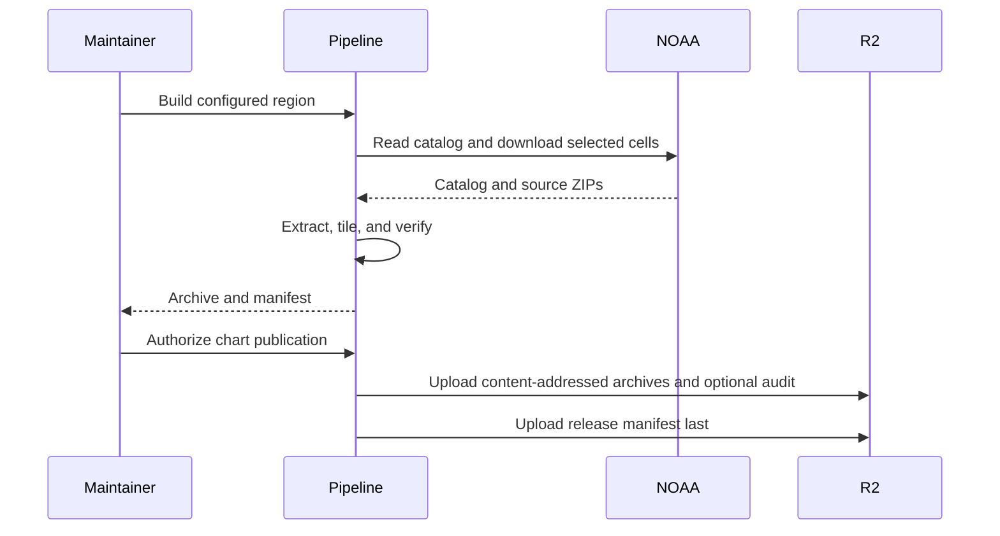
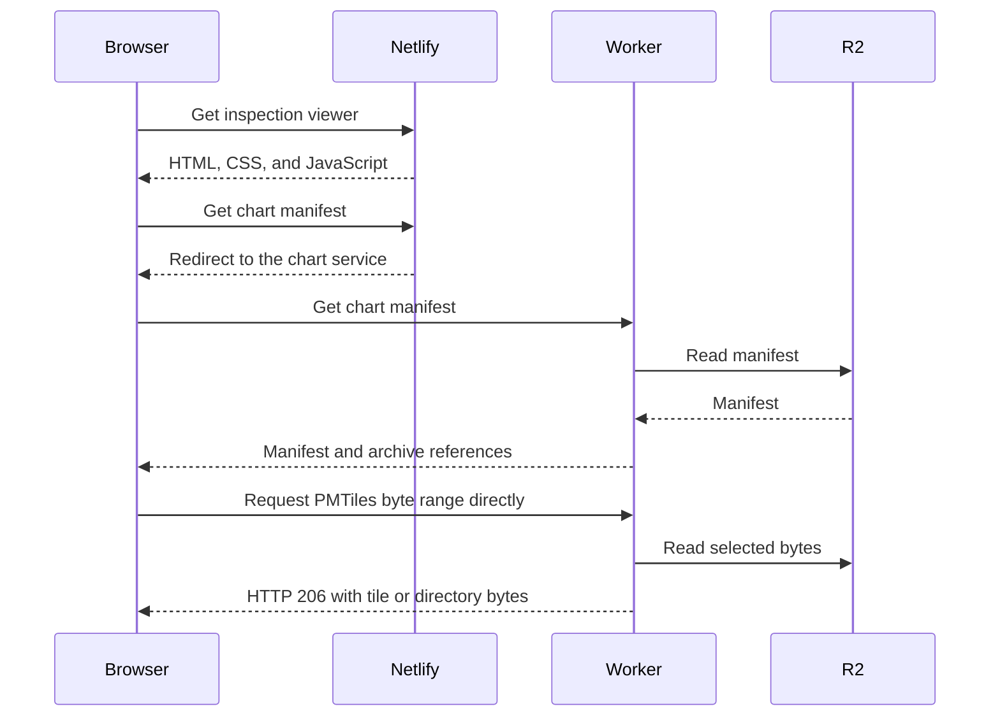
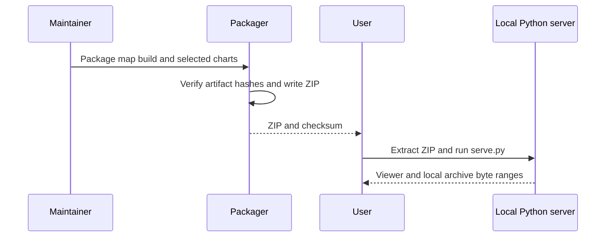

# Data flows

## Build and publish chart data

A rebuild can also use a retained catalog and ZIP snapshot. NOAA raster
imagery is imported separately. The publisher verifies the referenced files
before upload. If an archive upload fails, the public manifest continues to
refer to the previous release. The update checker reports changes for a
retained release. A scheduled candidate-release workflow is still planned.
See [hosting and publication](../../hosting/README.md).

## Browser viewing path

The viewer resolves archive paths using the host that returned the manifest.
This keeps byte-range requests away from the Netlify redirect.
Raster and vector mode behavior is documented in the
[raster chart view architecture](raster-chart-view.md).

## Offline bundle path

The default package includes the active vector archive. The combined package
adds matching raster imagery. When available, the vector coverage audit is
bundled with its archive. The ZIP is a point-in-time release with a local
manifest and no automatic sync. See [offline bundle instructions](../offline-bundle.md).
