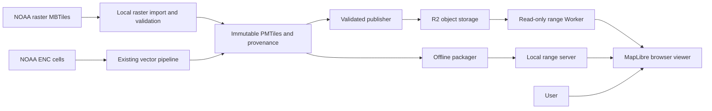

# Raster chart view architecture

Chart view and vector inspection are available in the hosted Puget Sound viewer
and in combined offline packages.
See [run instructions and measurements](../raster-chart-view.md).

## Context and containers

A user views pre-rendered charts or inspects extracted ENC features. NOAA supplies
the two inputs through separate distribution paths; matching dates and coverage
must not be assumed. The browser remains the only chart display runtime.

The [raster importer](../../pipeline/import_raster.py), publisher, and packager
handle the two archives independently.

## Browser components

[`web/chart-modes.js`](../../web/chart-modes.js) validates the raster descriptor,
switches modes while retaining the camera, and reports source status and scale
limits. [`web/main.js`](../../web/main.js) creates the MapLibre sources and
layers. Raster images retain their upstream portrayal.

## Publication and offline consistency

Validate artifacts, upload immutable objects, then replace the small manifest.
For manual rollback, retain a copy of the prior manifest. A reader must obtain a complete release
from one manifest, even during publication. Retain existing referenced archives;
cleanup is a separate operation.

Offline packaging copies the selected artifacts and writes a package-specific
manifest. Archive paths resolve against the local offline server. The optional coverage audit references the vector archive only. Raster
availability and coverage are separate metadata and UI concerns.

## Compatibility and limitations

Vector-only manifests remain supported. Failed raster requests produce a visible
error and an explicit route to inspection. Raster mode never identifies hidden
vector features, and does not reuse vector coverage as a raster coverage claim.
Native raster zoom limits control overzoom messaging. Publication dates may be
unknown and must be distinguished from download dates.

See [ADR 0009](../adr/0009-raster-chart-view-with-vector-inspection.md) and the
[work plan](../raster-chart-plan.md) for scope and acceptance criteria.
