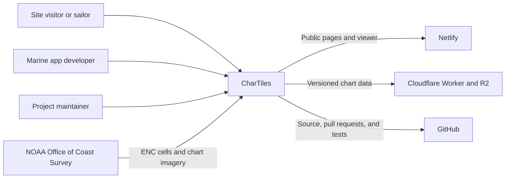

# System context (C4 level 1)

CharTiles makes selected NOAA chart features inspectable in a browser.
The public release covers a bounded Puget Sound region. The viewer is for
experimental chart inspection and carries a not-for-navigation notice.

Visitors use the public pages, read the blog, or open the experimental viewer.
Sailors can review the same chart artifacts using a locally served bundle.
Marine app developers can load the public archive in their own MapLibre app.
The maintainer selects NOAA inputs, validates each chart build, and publishes
it separately from the site. GitHub Actions runs PR tests with retained
fixtures.

NOAA supplies the source records and prepares the raster imagery. CharTiles
selects and repackages those inputs. Survey accuracy, official chart
publication, and chart carriage compliance remain outside its role.

See the [container view](containers.md) for the runtime boundary between the
site, chart service, and offline viewer.
