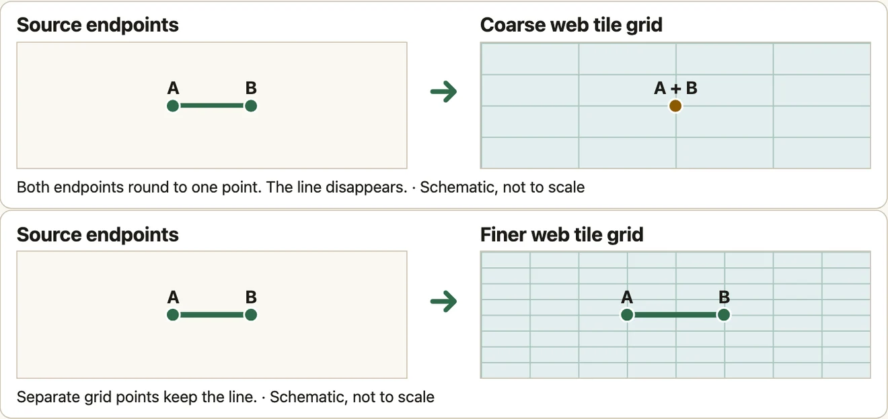

A short piece of coastline near Shilshole made it into the input for our Puget Sound map. It didn’t make it out. The first regional build failed because it couldn’t find the line’s ID in the finished tiles.

I sail on Puget Sound, and I started CharTiles because I wanted to click a mark on a web map and see what NOAA recorded about it. To do that, the web map needs the chart features behind the picture. CharTiles reads those features from NOAA’s electronic charts and packs them into vector tiles, small pieces the browser can request as you pan and zoom. The missing coastline turned out to be a lesson in what that packing step can change.

## Two ends, one grid point

The segment came from NOAA chart `US5SEAGK`. Its endpoints had longitudes of −122.4000003 and −122.4. Their latitudes differed by only 0.0000001 degrees. It was a very short line.

A vector tile stores positions as whole numbers on a grid. During the first build, both endpoints rounded to the same grid point. The line collapsed and its ID disappeared from the tile output. We changed Tippecanoe’s maximum-zoom grid precision with `--full-detail=16`. On the finer grid, the endpoints landed on separate points and the line survived. That preserved more of the geometry supplied to the compiler. It didn’t change how accurately the coast was surveyed.

## Check the tiles you actually made

The build now decodes the finished archive at zoom 16, its most detailed source zoom. For every extracted feature it looks for the full feature ID. For soundings, the depth measurements marked on the chart, it also compares the recorded depth. In the retained Puget Sound benchmark, all 47,262 extracted features were found and the sounding depths matched.

That check has a narrow job. It can miss a shape that changes while retaining its ID. It can’t tell you how features look zoomed out. It also can’t tell you whether two **source charts** agree along a shared edge. The Shilshole line vanished on a **web tile’s coordinate grid**. A coastline that already fails to join where two source charts meet needs a different check.

The next time I see a clean-looking map after a conversion, I want to know what we actually compared. If you know a place where two NOAA charts meet and a feature is hard to carry across, send us the chart IDs and a coordinate. That’s enough to start a small test.

- [CUGOS talk with the tile-grid diagrams](/cugos/)
- [Puget Sound benchmark and reproduction steps](https://github.com/ivanoats/chartiles/blob/main/docs/puget-sound-benchmark.md)
- [Report a chart boundary example](https://github.com/ivanoats/chartiles/issues)
